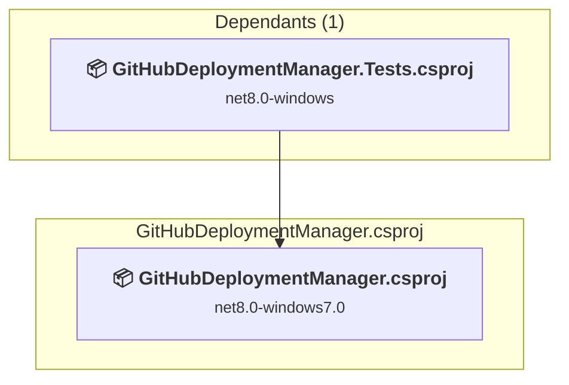
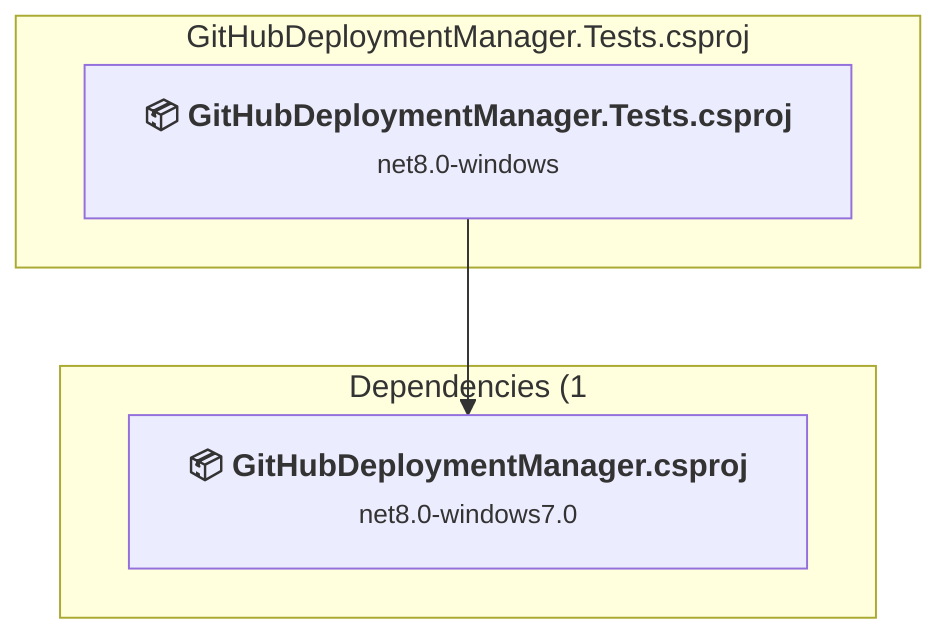

# Projects and dependencies analysis

This document provides a comprehensive overview of the projects and their dependencies in the context of upgrading to .NETCoreApp,Version=v10.0.

## Table of Contents

- [Executive Summary](#executive-Summary)
  - [Highlevel Metrics](#highlevel-metrics)
  - [Projects Compatibility](#projects-compatibility)
  - [Package Compatibility](#package-compatibility)
  - [API Compatibility](#api-compatibility)
  - [Binding Redirect Configuration](#binding-redirect-configuration)
- [Aggregate NuGet packages details](#aggregate-nuget-packages-details)
- [Top API Migration Challenges](#top-api-migration-challenges)
  - [Technologies and Features](#technologies-and-features)
  - [Most Frequent API Issues](#most-frequent-api-issues)
- [Projects Relationship Graph](#projects-relationship-graph)
- [Project Details](#project-details)

  - [GitHubDeploymentManager.csproj](#githubdeploymentmanagercsproj)
  - [GitHubDeploymentManager.Tests\GitHubDeploymentManager.Tests.csproj](#githubdeploymentmanagertestsgithubdeploymentmanagertestscsproj)

## Executive Summary

### Highlevel Metrics

| Metric | Count | Status |
| :--- | :---: | :--- |
| Total Projects | 2 | All require upgrade |
| Total NuGet Packages | 6 | 3 need upgrade |
| Total Code Files | 17 |  |
| Total Code Files with Incidents | 8 |  |
| Total Lines of Code | 2111 |  |
| Total Number of Issues | 1843 |  |
| Estimated LOC to modify | 1838+ | at least 87.1% of codebase |

### Projects Compatibility

| Project | Target Framework | Difficulty | Package Issues | API Issues | Binding Issues | Est. LOC Impact | Description |
| :--- | :---: | :---: | :---: | :---: | :---: | :---: | :--- |
| [GitHubDeploymentManager.csproj](#githubdeploymentmanagercsproj) | net8.0-windows7.0 | 🟡 Medium | 2 | 1831 | 0 | 1831+ | WinForms, Sdk Style = True |
| [GitHubDeploymentManager.Tests\GitHubDeploymentManager.Tests.csproj](#githubdeploymentmanagertestsgithubdeploymentmanagertestscsproj) | net8.0-windows | 🟢 Low | 1 | 7 | 0 | 7+ | DotNetCoreApp, Sdk Style = True |

### Package Compatibility

| Status | Count | Percentage |
| :--- | :---: | :---: |
| ✅ Compatible | 3 | 50.0% |
| ⚠️ Incompatible | 1 | 16.7% |
| 🔄 Upgrade Recommended | 2 | 33.3% |
| ***Total NuGet Packages*** | ***6*** | ***100%*** |

### API Compatibility

| Category | Count | Impact |
| :--- | :---: | :--- |
| 🔴 Binary Incompatible | 1677 | High - Require code changes |
| 🟡 Source Incompatible | 138 | Medium - Needs re-compilation and potential conflicting API error fixing |
| 🔵 Behavioral change | 23 | Low - Behavioral changes that may require testing at runtime |
| ✅ Compatible | 2344 |  |
| ***Total APIs Analyzed*** | ***4182*** |  |

## Aggregate NuGet packages details

| Package | Current Version | Suggested Version | Projects | Description |
| :--- | :---: | :---: | :--- | :--- |
| coverlet.collector | 6.0.0 |  | [GitHubDeploymentManager.Tests.csproj](#githubdeploymentmanagertestsgithubdeploymentmanagertestscsproj) | ✅Compatible |
| Microsoft.Extensions.DependencyInjection | 8.0.1 | 10.0.11 | [GitHubDeploymentManager.csproj](#githubdeploymentmanagercsproj) | NuGet package upgrade is recommended |
| Microsoft.NET.Test.Sdk | 17.8.0 |  | [GitHubDeploymentManager.Tests.csproj](#githubdeploymentmanagertestsgithubdeploymentmanagertestscsproj) | ✅Compatible |
| System.Configuration.ConfigurationManager | 8.0.1 | 10.0.11 | [GitHubDeploymentManager.csproj](#githubdeploymentmanagercsproj) | NuGet package upgrade is recommended |
| xunit | 2.5.3 |  | [GitHubDeploymentManager.Tests.csproj](#githubdeploymentmanagertestsgithubdeploymentmanagertestscsproj) | ⚠️NuGet package is deprecated |
| xunit.runner.visualstudio | 2.5.3 |  | [GitHubDeploymentManager.Tests.csproj](#githubdeploymentmanagertestsgithubdeploymentmanagertestscsproj) | ✅Compatible |

## Top API Migration Challenges

### Technologies and Features

| Technology | Issues | Percentage | Migration Path |
| :--- | :---: | :---: | :--- |
| Windows Forms | 1677 | 91.2% | Windows Forms APIs for building Windows desktop applications with traditional Forms-based UI that are available in .NET on Windows. Enable Windows Desktop support: Option 1 (Recommended): Target net9.0-windows; Option 2: Add <UseWindowsDesktop>true</UseWindowsDesktop>; Option 3 (Legacy): Use Microsoft.NET.Sdk.WindowsDesktop SDK. |
| GDI+ / System.Drawing | 106 | 5.8% | System.Drawing APIs for 2D graphics, imaging, and printing that are available via NuGet package System.Drawing.Common. Note: Not recommended for server scenarios due to Windows dependencies; consider cross-platform alternatives like SkiaSharp or ImageSharp for new code. |
| Legacy Configuration System | 28 | 1.5% | Legacy XML-based configuration system (app.config/web.config) that has been replaced by a more flexible configuration model in .NET Core. The old system was rigid and XML-based. Migrate to Microsoft.Extensions.Configuration with JSON/environment variables; use System.Configuration.ConfigurationManager NuGet package as interim bridge if needed. |

### Most Frequent API Issues

| API | Count | Percentage | Category |
| :--- | :---: | :---: | :--- |
| T:System.Windows.Forms.DockStyle | 120 | 6.5% | Binary Incompatible |
| T:System.Windows.Forms.Label | 104 | 5.7% | Binary Incompatible |
| T:System.Windows.Forms.Padding | 90 | 4.9% | Binary Incompatible |
| T:System.Windows.Forms.SizeType | 82 | 4.5% | Binary Incompatible |
| T:System.Windows.Forms.Button | 44 | 2.4% | Binary Incompatible |
| T:System.Drawing.Font | 40 | 2.2% | Source Incompatible |
| P:System.Windows.Forms.Control.Dock | 40 | 2.2% | Binary Incompatible |
| T:System.Windows.Forms.TextBox | 37 | 2.0% | Binary Incompatible |
| P:System.Windows.Forms.Label.Text | 31 | 1.7% | Binary Incompatible |
| P:System.Windows.Forms.Control.Margin | 31 | 1.7% | Binary Incompatible |
| T:System.Windows.Forms.TableLayoutControlCollection | 31 | 1.7% | Binary Incompatible |
| P:System.Windows.Forms.TableLayoutPanel.Controls | 31 | 1.7% | Binary Incompatible |
| M:System.Windows.Forms.TableLayoutControlCollection.Add(System.Windows.Forms.Control,System.Int32,System.Int32) | 31 | 1.7% | Binary Incompatible |
| T:System.Windows.Forms.RowStyle | 28 | 1.5% | Binary Incompatible |
| T:System.Windows.Forms.TableLayoutRowStyleCollection | 28 | 1.5% | Binary Incompatible |
| P:System.Windows.Forms.TableLayoutPanel.RowStyles | 28 | 1.5% | Binary Incompatible |
| M:System.Windows.Forms.TableLayoutRowStyleCollection.Add(System.Windows.Forms.RowStyle) | 28 | 1.5% | Binary Incompatible |
| T:System.Windows.Forms.AutoSizeMode | 27 | 1.5% | Binary Incompatible |
| P:System.Windows.Forms.Control.ForeColor | 26 | 1.4% | Binary Incompatible |
| T:System.Windows.Forms.Panel | 25 | 1.4% | Binary Incompatible |
| T:System.Drawing.ContentAlignment | 24 | 1.3% | Source Incompatible |
| T:System.Windows.Forms.ProgressBar | 23 | 1.3% | Binary Incompatible |
| T:System.Windows.Forms.FlowLayoutPanel | 22 | 1.2% | Binary Incompatible |
| T:System.Windows.Forms.Control.ControlCollection | 22 | 1.2% | Binary Incompatible |
| P:System.Windows.Forms.Control.Controls | 22 | 1.2% | Binary Incompatible |
| M:System.Windows.Forms.Padding.#ctor(System.Int32) | 22 | 1.2% | Binary Incompatible |
| F:System.Windows.Forms.DockStyle.Fill | 21 | 1.1% | Binary Incompatible |
| M:System.Windows.Forms.Padding.#ctor(System.Int32,System.Int32,System.Int32,System.Int32) | 20 | 1.1% | Binary Incompatible |
| P:System.Windows.Forms.Control.Font | 20 | 1.1% | Binary Incompatible |
| P:System.Windows.Forms.Control.BackColor | 20 | 1.1% | Binary Incompatible |
| F:System.Windows.Forms.SizeType.AutoSize | 20 | 1.1% | Binary Incompatible |
| M:System.Windows.Forms.RowStyle.#ctor(System.Windows.Forms.SizeType) | 20 | 1.1% | Binary Incompatible |
| P:System.Windows.Forms.TextBox.Text | 19 | 1.0% | Binary Incompatible |
| M:System.Drawing.Font.#ctor(System.String,System.Single) | 19 | 1.0% | Source Incompatible |
| F:System.Windows.Forms.DockStyle.Top | 19 | 1.0% | Binary Incompatible |
| P:System.Windows.Forms.Control.Padding | 17 | 0.9% | Binary Incompatible |
| M:System.Windows.Forms.Control.ControlCollection.Add(System.Windows.Forms.Control) | 16 | 0.9% | Binary Incompatible |
| T:System.Configuration.ConfigurationManager | 14 | 0.8% | Source Incompatible |
| P:System.Configuration.ConfigurationManager.AppSettings | 14 | 0.8% | Source Incompatible |
| T:System.Windows.Forms.FlowDirection | 14 | 0.8% | Binary Incompatible |
| F:System.Windows.Forms.SizeType.Absolute | 13 | 0.7% | Binary Incompatible |
| T:System.Windows.Forms.ColumnStyle | 13 | 0.7% | Binary Incompatible |
| M:System.Windows.Forms.ColumnStyle.#ctor(System.Windows.Forms.SizeType,System.Single) | 13 | 0.7% | Binary Incompatible |
| T:System.Windows.Forms.TableLayoutColumnStyleCollection | 13 | 0.7% | Binary Incompatible |
| P:System.Windows.Forms.TableLayoutPanel.ColumnStyles | 13 | 0.7% | Binary Incompatible |
| M:System.Windows.Forms.TableLayoutColumnStyleCollection.Add(System.Windows.Forms.ColumnStyle) | 13 | 0.7% | Binary Incompatible |
| T:System.Uri | 11 | 0.6% | Behavioral Change |
| T:System.Windows.Forms.Control | 11 | 0.6% | Binary Incompatible |
| P:System.Windows.Forms.Label.AutoSize | 11 | 0.6% | Binary Incompatible |
| T:System.Windows.Forms.MessageBoxIcon | 10 | 0.5% | Binary Incompatible |

## Projects Relationship Graph

Legend:
📦 SDK-style project
⚙️ Classic project

## Project Details

### GitHubDeploymentManager.csproj

#### Project Info

- **Current Target Framework:** net8.0-windows7.0
- **Proposed Target Framework:** net10.0-windows
- **SDK-style**: True
- **Project Kind:** WinForms
- **Dependencies**: 0
- **Dependants**: 1
- **Number of Files**: 16
- **Number of Files with Incidents**: 6
- **Lines of Code**: 1932
- **Estimated LOC to modify**: 1831+ (at least 94.8% of the project)

#### Dependency Graph

Legend:
📦 SDK-style project
⚙️ Classic project

### API Compatibility

| Category | Count | Impact |
| :--- | :---: | :--- |
| 🔴 Binary Incompatible | 1677 | High - Require code changes |
| 🟡 Source Incompatible | 137 | Medium - Needs re-compilation and potential conflicting API error fixing |
| 🔵 Behavioral change | 17 | Low - Behavioral changes that may require testing at runtime |
| ✅ Compatible | 2052 |  |
| ***Total APIs Analyzed*** | ***3883*** |  |

#### Project Technologies and Features

| Technology | Issues | Percentage | Migration Path |
| :--- | :---: | :---: | :--- |
| Legacy Configuration System | 28 | 1.5% | Legacy XML-based configuration system (app.config/web.config) that has been replaced by a more flexible configuration model in .NET Core. The old system was rigid and XML-based. Migrate to Microsoft.Extensions.Configuration with JSON/environment variables; use System.Configuration.ConfigurationManager NuGet package as interim bridge if needed. |
| GDI+ / System.Drawing | 106 | 5.8% | System.Drawing APIs for 2D graphics, imaging, and printing that are available via NuGet package System.Drawing.Common. Note: Not recommended for server scenarios due to Windows dependencies; consider cross-platform alternatives like SkiaSharp or ImageSharp for new code. |
| Windows Forms | 1677 | 91.6% | Windows Forms APIs for building Windows desktop applications with traditional Forms-based UI that are available in .NET on Windows. Enable Windows Desktop support: Option 1 (Recommended): Target net9.0-windows; Option 2: Add <UseWindowsDesktop>true</UseWindowsDesktop>; Option 3 (Legacy): Use Microsoft.NET.Sdk.WindowsDesktop SDK. |

### GitHubDeploymentManager.Tests\GitHubDeploymentManager.Tests.csproj

#### Project Info

- **Current Target Framework:** net8.0-windows
- **Proposed Target Framework:** net10.0--windows
- **SDK-style**: True
- **Project Kind:** DotNetCoreApp
- **Dependencies**: 1
- **Dependants**: 0
- **Number of Files**: 4
- **Number of Files with Incidents**: 2
- **Lines of Code**: 179
- **Estimated LOC to modify**: 7+ (at least 3.9% of the project)

#### Dependency Graph

Legend:
📦 SDK-style project
⚙️ Classic project

### API Compatibility

| Category | Count | Impact |
| :--- | :---: | :--- |
| 🔴 Binary Incompatible | 0 | High - Require code changes |
| 🟡 Source Incompatible | 1 | Medium - Needs re-compilation and potential conflicting API error fixing |
| 🔵 Behavioral change | 6 | Low - Behavioral changes that may require testing at runtime |
| ✅ Compatible | 292 |  |
| ***Total APIs Analyzed*** | ***299*** |  |

